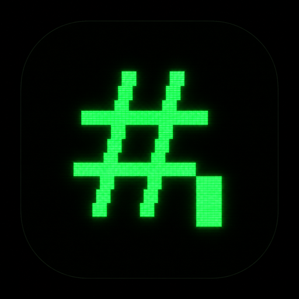

<p align="center">
  
</p>

<h1 align="center">Hashes</h1>

<p align="center"><b>A solo Bitcoin miner for Android with a 100% monochrome green CRT terminal.</b><br>
Real mainnet headers, hashed on the phone. No account. No wallet. No seed.</p>

<p align="center">
  
  
  
  
  
  
  
</p>

```
root@hashes:~$ ./hashes --mainnet

  HASHES   MAINNET DOUBLE SHA-256 SOLO MINER
  ─────────────────────────────────────────────
  BLOCK_HEIGHT   912,344        PREV_HASH   0000000000000000…7c1e
  PAYOUT_ADDR    bc1q…9f2a       NET_TARGET  0000000000000000…0000
  NONCE_COUNTER  0x1dac2b7c     HASHRATE    ▓▓▓▓▓▓▓░░░ 2.41 MH/s
  LIVE_HASH_STREAM
    0000000000000000002f1a…5c7d   ← 4 zeros, inverted
    000000000000000000a9e3…b210
  STATUS  MINING · TURBO · 7 THREADS · 41.2 C
  root@hashes:~$ _
```

Hashes takes work from a solo Stratum V1 pool, assembles the 80-byte block header
on the phone, and hashes it with the ARMv8 SHA-256 instructions, printing every
digest as it is produced. If a hash meets the target it is submitted to the pool,
and a block the pool accepts pays the payout address in its own coinbase. The app
never asks for a private key or a seed phrase, has no account and uses no Google
Play Services: the only thing it knows about you is the address you type or scan.

**Download.** Grab the current APK from
[Releases](../../releases/latest) and install it (allow "install unknown apps"
for the app you open it with). Google Play does not accept mainnet mining, so
GitHub Releases and F-Droid are the distribution paths.

Package `com.corejbh.hashes`, `minSdk` 26, `targetSdk` 36, `arm64-v8a` only.

---

## What it does, and what it refuses to do

| It does | It never does |
| --- | --- |
| Hash real mainnet block headers from a solo pool, with the nonce, digest and hash stream the device actually produced | Simulate mining or show a number it did not compute |
| Keep the session running while you use another app, as a foreground service with the live rate in the status bar and a `STOP` action there | Keep hashing after you stop it - the button, the notification or a swipe out of the recent tasks all end the session |
| Validate the payout address before a socket opens: Base58Check `1…`/`3…`, Bech32 `bc1q…`, Bech32m `bc1p…`, checksum verified, testnet refused | Ask for a private key, a seed phrase, an account or an email |
| Scan a payout address from a QR code with CameraX + ZXing, with no Play Services and no ML Kit | Promise a block; the odds line is the honest expected time at the measured rate |
| Submit a found share against the job it came from, and never reuse a stale job after a reconnect | Report a worker rate or a bar the engine did not produce |
| Step TURBO down when the phone gets hot, and say so on screen | Use the debug key as a release fallback, or ship an unsigned release without being told to |

## The terminal

The terminal fills the whole screen at any height. The session facts and the hash
stream take the top, the worker monitor and the event log take the middle, and
the TURBO line and the two buttons are pinned to the bottom edge; the stream and
the log stretch to whatever height is left, and a short screen (landscape, a split
view) switches to a scrolling column instead of cutting anything off.

One palette: `#030604` field, `#00FF66` phosphor, emphasis by inversion, one
monospace face, scanlines over the whole screen. Nothing is decorated that is not
information.

- **Splash**: a CRT boot — scanlines, a bright scan band, the mark drawn in
  phosphor, then the terminal.
- **Block panel**: `BLOCK_HEIGHT`, `PREV_HASH`, `PAYOUT_ADDR`, `NET_TARGET` for the
  job being hashed, plus the network difficulty and the odds.
- **Live hash stream**: the newest digests, a near miss (four or more leading
  zeros) inverted so it is visible at a glance, drawn down to the last line the
  panel has room for.
- **Best shares**: `SESSION_BEST_SHARE` for this run and `ALL_TIME_BEST` across
  restarts.
- **Telemetry**: hashrate, tries, nonce counter, thread count, temperature, and the
  engine in use (`NATIVE (ARMV8 SHA2-256)` or `KOTLIN-FALLBACK`).
- **`WORKERS`**: an `htop`-style bar per worker thread from the core's own
  per-worker counters, with `TURBO 7T` or `TURBO 4T / CAP 7T` when the thermal
  guard has capped the set, and live `HASHRATE` and `TEMP` sparklines over the last
  24 seconds.
- **`EVENT_LOG`**: the session's notices (jobs, shares, link changes, thermal
  steps), newest first, filling the height the layout gives it.
- **`POOL & PAYOUT`**: pool presets, a custom `stratum+ssl://host:port` endpoint,
  and `PAYOUT_TARGET>` with `[ PASTE ]` and `[ SCAN_QR ]`.

## How the hashing works

| Layer | Where | What it does |
| --- | --- | --- |
| SHA-256 compression | `app/src/main/cpp/sha256_arm64_crypto.c` | `SHA256H`/`H2`/`SU0`/`SU1` intrinsics. **This file alone** is compiled with `-march=armv8-a+crypto` |
| Portable compression | `app/src/main/cpp/sha256_portable.c` | FIPS 180-4 reference C, correct on every ABI, used by the host tests |
| Dispatch | `app/src/main/cpp/sha256_dispatch.c` | One `getauxval(AT_HWCAP) & HWCAP_SHA2` check, then a function pointer |
| Header hashing | `app/src/main/cpp/block_header.h` | Midstate over header bytes 0..63 once per job, then per nonce: 12 fixed bytes, the 4-byte nonce, padding, and the second SHA-256 |
| Engine | `app/src/main/cpp/miner.cpp` | `std::thread` workers, `std::atomic` counters, one consistent snapshot, a found-hash queue, a 32-bit nonce walk that stops at the end of the space |
| JNI | `app/src/main/cpp/jni_bridge.cpp` | Ten exported methods, named exactly as `com.corejbh.hashes.engine.NativeMiner` resolves them |
| Bridge | `engine/NativeMiner.kt`, `engine/NativeMinerBinding.kt` | The declarations, and an interface the JVM tests can fake |
| Native adapter | `engine/NativeMiningEngine.kt` | Turns counters into `EngineSnapshot`, found hashes into `FoundShare` |
| Kotlin fallback | `engine/FallbackHashEngine.kt` | The same algorithm in Kotlin, for emulators, previews and JVM tests — slow, but real |
| Network | `network/` | Stratum V1 over TLS or TCP, backoff, coinbase/merkle/header assembly, compact target arithmetic, BIP34 height |
| Addresses | `crypto/` | SHA-256 (Kotlin), Bech32/Bech32m, Base58Check, BIP-21 URI extraction |
| Thermal | `thermal/` | `ThermalMonitor` reads the OS, `ThermalPolicy` decides, `ThermalGuard` applies |
| Session | `session/` | `MiningSession`: the engine, the pool link, the thermal guard and the one-second loop, process-wide and screen-independent |
| Service | `service/` | `MinerForegroundService`: a `dataSync` foreground service, its notification and its `STOP` action |
| UI | `ui/` | Compose terminal, splash, settings sheet, address field, hash stream, worker monitor, QR scanner |

**A SIGILL is impossible by construction.** The extension flag is a per-source
compile option on one translation unit. Every other translation unit is built for
plain armv8-a, and the accelerated function is reachable only through the pointer
that the dispatcher binds after asking the kernel whether the CPU has the SHA2
extension. The built library carries `sha256h`/`sha256h2`/`sha256su` instructions
and the portable code, and the shipped object files bear this out: only
`sha256_arm64_crypto.c.o` contains a SHA-2 instruction.

**No JNI call per hash.** Kotlin hands over a job, flips the mode, and reads eight
counters about thirty times a second. The only locks on that path are over the
current digest and the best digest.

## Bridge contract

`docs/native-bridge-contract.md` is the contract; `NativeMiner` declares it and
`scripts/`-independent unit tests check the declarations against the C++ exports.

| Method | Purpose |
| --- | --- |
| `nativeStart(headerPrefix, target, nonceStart, turbo, dutyHashMicros, dutySleepMicros)` | Start a job; false when the workers cannot be created |
| `nativeUpdateWork(headerPrefix, target, nonceStart)` | Swap the job under the running workers |
| `nativeSetTurboMode(turbo)` | COOL (one thread, duty cycle) or TURBO (every worker, background priority) |
| `nativeSetThreadCap(threads)` | Cap how many workers TURBO may use (the MODERATE thermal step) |
| `nativeStop()` | Stop and join; idempotent |
| `nativePollCounters(out[8])` | state, hashes, nonce, threads, hash rate, best zero nibbles, flags, reserved |
| `nativePollThreadHashes(out[8])` | Cumulative hashes per worker slot, and how many slots the mode runs |
| `nativePollCurrentHash(out)` | The most recent digest, internal order |
| `nativePollBestHash(out)` | `Boolean`: best digest of the job written, or none yet |
| `nativePollFoundHash(out)` | `Long`: nonce of the oldest found hash, or -1 |
| `nativeVersion()` | Human-readable core version |

A nonce is 32 bits and the walk never wraps: reaching `0xFFFFFFFF` finishes the
job rather than repeating the space.

## COOL, TURBO and the thermal guard

- **COOL** (default): one worker, 1.5 ms of hashing in every ~32.5 ms window — a
  30 fps duty cycle that keeps the CPU share low and the frame pacing natural.
- **TURBO**: every worker thread (cores minus one, at most eight) at background
  priority, so a busy UI thread still gets its frames.
- **MODERATE** (`PowerManager.THERMAL_STATUS_MODERATE`, or 40.0 C battery):
  TURBO keeps running on half its workers through `nativeSetThreadCap`. The phone
  loses speed, not the session.
- **SEVERE** (or 43.0 C): the first reading caps TURBO to a single worker; the
  second consecutive one switches TURBO off, persists the setting, and prints
  `THERMAL GUARD` with a `[ RESET THERMAL GUARD ]` button. TURBO stays refused
  until that reset, so a hot phone is never one tap away from full speed.
- API 26-28 have no thermal status API, so the same two thresholds are applied to
  the battery temperature from the sticky battery broadcast.

## Leaving the screen

The session belongs to the process, not to the activity. Pressing
`[ START / STOP MINER ]` starts `MINERFOREGROUNDSERVICE`, a `dataSync` foreground
service that holds the pool socket and the worker set; the terminal only reads the
session and turns it into frames. Going back to the home screen or into another
app pauses the 30 fps polling and nothing else - the hash rate keeps counting,
found shares keep being submitted, and the status-bar notification refreshes every
second with the mode, the link state, the live rate and the height.

It ends in exactly three places: the button, the notification's `STOP`, and a
swipe of the app out of the recent tasks (`onTaskRemoved`). All three stop the
workers, close the socket and remove the notification. `START_NOT_STICKY` means
the system never brings a session back on its own, and the Android 15+ daily
budget for `dataSync` services ends it visibly rather than invisibly.

On Android 13+ the app asks for `POST_NOTIFICATIONS` the first time a session
starts. A refusal does not stop the service - the shade simply stays empty and
the running service remains listed in the system's task manager.

## Design rules the code keeps

- **English only, everywhere**, and the brand string appears nowhere except
  inside the package identifier — `scripts/verify-english.py` enforces both over
  every text file, resource, store description and prompt.
- **No key material.** The app has no wallet: the only input that identifies you
  is a payout address, and a pool pays it in the coinbase of any block found.
- **Mainnet only.** Testnet and regtest addresses are refused before a socket
  opens.
- **Honest numbers.** Every hash, nonce and share on screen was produced by this
  device; the odds line is difficulty × 2³² ÷ the measured rate, and each worker
  bar is a difference of that worker's own counter.
- **Visible in the background, or not at all.** A session that outlives the screen
  runs as a `dataSync` foreground service with its live rate in the status bar and
  a `STOP` action there; stopping it - button, notification or a swipe out of the
  recent tasks - ends it and removes the notification.

## Build

Requirements: JDK 17, Android SDK with platform 36, **NDK 30.0.16248370** and
**CMake 3.22.1** (both pinned in `app/build.gradle.kts`), Gradle 8.13 (wrapper
included).

```sh
export JAVA_HOME=/path/to/jdk-17
export ANDROID_HOME=/path/to/android-sdk
./gradlew :app:assembleDebug
```

The APK carries `lib/arm64-v8a/libhashes.so`, built from `app/src/main/cpp` by
CMake during the build; no prebuilt binary is committed.

Release builds are signed or they do not happen. The key comes from
`keystore/keystore.properties` (never committed) or from `HASHES_KEYSTORE_FILE`,
`HASHES_KEYSTORE_PASSWORD`, `HASHES_KEY_ALIAS` and `HASHES_KEY_PASSWORD`; the
debug key is never a fallback. A builder that signs the artifact with its own key
— F-Droid does — asks for an unsigned release explicitly:

```sh
./gradlew :app:assembleRelease -Phashes.unsignedRelease=true
```

Reproducibility: `dependenciesInfo` is false for APK and bundle, the NDK and CMake
versions are fixed, and CMake passes `-ffile-prefix-map` for the source and build
directories so no build-host path reaches an object file.

## Tests

```sh
./gradlew :app:testDebugUnitTest     # 173 JVM tests
./gradlew :app:lintDebug             # no errors; warnings are dependency versions
python3 scripts/verify-english.py    # English only, brand only in the package name
```

The JVM suite covers the parts a device is not needed for:

- a Kotlin reimplementation of double SHA-256 and the midstate path against real
  mainnet headers (genesis, block 100000), plus a real QR encode → luminance
  decode → BIP-21 → address validation loop
- coinbase reassembly, coinbase txid, merkle root and the exact 80-byte header of
  block 100000, byte for byte, and its hash
- Stratum message parsing from real payloads, the client over a fake transport
  (subscribe, authorize, notify, submit, share reply, refused authorization),
  backoff, endpoint parsing
- compact target arithmetic and difficulty, address validation for every format
  including checksum typos and testnet refusal
- the JNI declarations against the C++ exports (names, `Boolean`/`Long` returns,
  the thread cap), the counter layout, and the thermal policy and guard
- best-share persistence, formatting, the hash stream ring buffer

The C core has its own tests, run on the host and, for the ARMv8 path, for
`arm64-v8a` under qemu:

```sh
CC=cc CXX=c++ ./scripts/run-native-tests.sh

CC=$ANDROID_NDK/toolchains/llvm/prebuilt/linux-x86_64/bin/aarch64-linux-android26-clang \
QEMU_AARCH64=qemu-aarch64-static \
./scripts/run-native-tests-aarch64.sh
```

The vectors are the genesis block, block 1 and block 170000: their double SHA-256
is public, and each test also checks that the mined header meets its own target
and that the midstate path equals a full double hash. SHA-256 itself is checked
against the FIPS 180-4 vectors ("abc", empty, a 56-byte two-block message, one
million `a`).

## Distribution

Google Play does not accept mainnet mining, so the release path is GitHub
Releases and F-Droid. F-Droid needs a reproducible build, which is why the NDK
and CMake versions are pinned, dependency metadata is stripped, `-ffile-prefix-map`
is passed, and the release is built unsigned with `-Phashes.unsignedRelease=true`
when a builder signs it with its own key. `fastlane/metadata/android/en-US/`
carries the title, descriptions, changelog and 512 px store icon.

## Roadmap

- **Phase 1** — C/NDK hash core, JNI bridge, thermal policy, project skeleton.
- **Phase 2** — Stratum V1, pool presets, address validation, coinbase/merkle
  assembly.
- **Phase 3** — CRT terminal, splash, settings sheet, paste/QR payout target,
  adaptive `#_` icon, store metadata.
- **Phase 4 (next)** — signed arm64 release, a real-pool session and a
  real-device thermal run, the site entry, and the reproducible-build check.

## Privacy

No analytics, no accounts, no Google Play Services. The only network connection
is the pool you chose, and the only personal datum the app holds is the payout
address you entered, in its own preferences file. `PRIVACY.md` has the details.

## Licence

See `LICENSE`.
